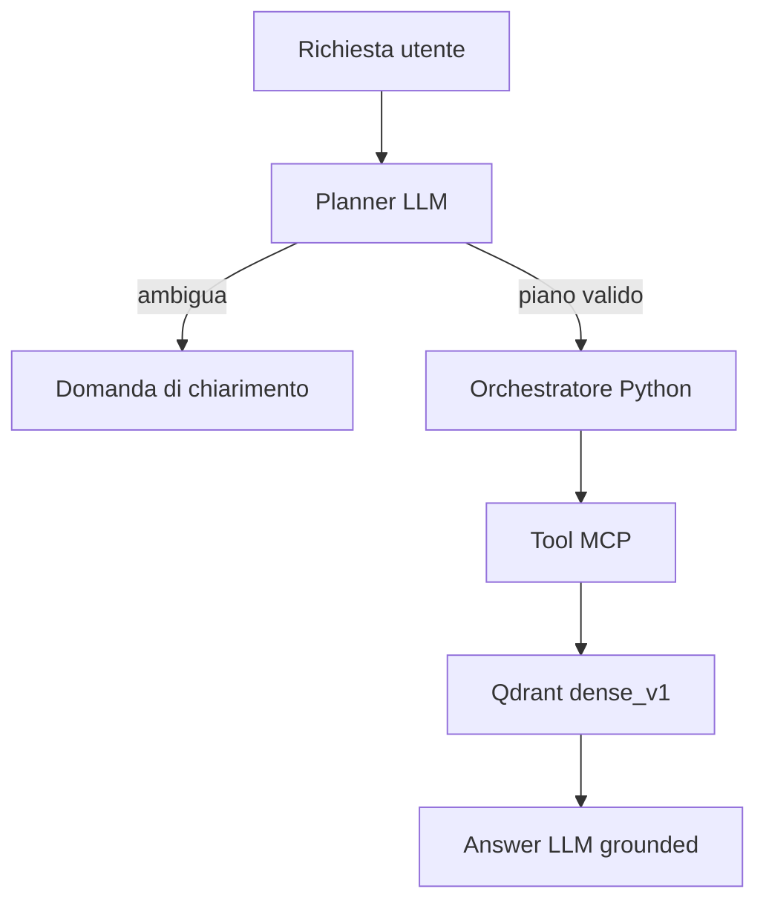

# Orchestrazione LLM v1 — Movie RAG

## Scopo della prima integrazione

Questa versione aggiunge una LLM al retriever già validato senza spostare nella
LLM le decisioni che devono restare deterministiche. Il flusso predefinito è:



Il Critic è implementato ma disabilitato nel profilo `grounded_v1`. Può essere
abilitato per un esperimento separato:

```text
Planner → search_movies → Critic → [al massimo N retry semantici] → Answer
```

Il risultato sperimentale corrente resta `dense_v1`: il workflow normale non
seleziona il profilo con reranker.

## Cosa significa “agente” in questo progetto

Un agente è un ruolo logico composto da:

1. prompt di sistema versionato;
2. profilo provider/modello;
3. schema Pydantic di output;
4. metodo `run(...)`.

Non è necessariamente un processo autonomo e non chiama funzioni in autonomia.
La chiamata `critic.run(state)`, per esempio, esegue una normale richiesta al
provider configurato. Il codice valida la risposta e decide se proseguire,
richiamare MCP, fermarsi o chiedere un chiarimento.

Questa distinzione è importante: la LLM propone dati strutturati, mentre il
codice possiede il grafo di esecuzione.

## Confini dei componenti

| Componente | Responsabilità | Non può fare |
|---|---|---|
| `PlannerAgent` | lingua, query semantica, filtri, ambiguità | chiamare MCP, scegliere modello dense/reranker |
| `CriticAgent` | accettare, proporre una sola nuova query o chiedere chiarimento | cambiare i filtri, ampliare il catalogo |
| `AnswerAgent` | risposta nella lingua dell’utente usando risultati e dettagli | inventare ID/titoli o usare conoscenza esterna |
| `MovieAssistantWorkflow` | stato, transizioni, limiti di retry, tool call | generare contenuto linguistico |
| `MCPMovieToolGateway` | chiamare e validare i due tool pubblici | scegliere un profilo tecnico per query |
| server MCP | retrieval e dettagli catalogo | interpretare conversazioni o orchestrare agenti |

## Contratti strutturati

Gli oggetti principali sono definiti in `llm_contract.py`:

- `RetrievalPlan`: `search` oppure `clarify`, query semantica e filtri esatti;
- `CriticDecision`: `accept`, `retry` oppure `clarify`;
- `GroundedAnswer`: testo finale e raccomandazioni ancorate a `movie_id`;
- `ConversationState`: stato serializzabile dell’intero turno;
- `LLMCallTrace` e `ToolCallTrace`: modello, prompt, token, durata e tool, senza
  prompt completi né credenziali.

Pydantic rifiuta campi imprevisti. Dopo la validazione dello schema,
`AnswerAgent` applica anche regole applicative:

- ogni `movie_id` deve comparire nei risultati MCP;
- il titolo deve coincidere con quello del catalogo;
- lo stesso film non può essere ripetuto;
- se MCP restituisce `no_results`, la risposta non può contenere film.

## MCP rimane un confine stabile

L’orchestratore usa soltanto:

```text
search_movies(query, filters, limit)
get_movie_details(movie_ids)
```

Provider LLM, modello, reranker e collection non vengono esposti nel prompt e
non sono argomenti dei tool di produzione. Il server MCP continua a scegliere
il profilo tecnico tramite la sua configurazione. Il tool sperimentale resta
disponibile per ablation manuali, ma non viene fornito al workflow normale.

`MCPMovieToolGateway` rende il client MCP compatibile con l’orchestratore e
valida nuovamente l’output. `ServiceMovieToolGateway` offre lo stesso contratto
senza trasporto MCP, utile nei test; non va usato per misurare il costo del
round-trip MCP.

## Provider e modelli configurabili

`configs/llm_profiles_v1.json` contiene tre livelli distinti:

```text
llm_profiles  → provider, modello, env della chiave, parametri
agents        → ruolo, prompt versionato, llm_profile
workflows     → agenti, policy, limiti e lingua catalogo
```

La configurazione iniziale associa tutti i ruoli a `gemini_free`, ma ogni ruolo
può usare un profilo diverso:

```bash
export MOVIE_RAG_PLANNER_LLM_PROFILE=gemini_free
export MOVIE_RAG_ANSWER_LLM_PROFILE=openai_default
```

Gli override devono riferirsi a profili già dichiarati nel JSON. Una richiesta
utente non può passare un nome modello arbitrario.

Adapter implementati:

- `GeminiProvider`, basato sul pacchetto ufficiale `google-genai`;
- `OpenAIProvider`, basato sulla Responses API e structured outputs;
- endpoint locale o gateway tramite `OPENAI_BASE_URL`, se implementa la
  Responses API e gli structured outputs usati dall'adapter.

Per un runtime locale con API differente si aggiunge un nuovo adapter che
implementa `LLMProvider`; agenti e workflow non cambiano.

## Segreti e `.env`

Le classi leggono esclusivamente il nome della variabile definito nel profilo,
per esempio `GEMINI_API_KEY`. La chiave non entra nei modelli di configurazione,
nelle trace o nel notebook.

Il package non carica implicitamente `.env`: un’applicazione deve decidere da
dove caricarlo. Il notebook usa esplicitamente:

```python
from dotenv import load_dotenv
load_dotenv(PROJECT_ROOT / ".env")
```

`.env` e `.venv/` sono esclusi da Git. `configs/llm.env.example` può essere
versionato perché contiene soltanto nomi e commenti.

## Flusso deterministico in dettaglio

1. Il Planner riceve la richiesta, la lingua del catalogo, i filtri supportati e
   la policy di riscrittura.
2. Se risponde `clarify`, il workflow termina senza chiamare MCP.
3. Se risponde `search`, Python chiama `search_movies` con gli stessi filtri
   validati.
4. Se il Critic è attivo, può proporre soltanto una nuova query semantica. I
   filtri vengono riutilizzati dallo stato e il numero di retry è limitato.
5. Per i primi risultati vengono richiesti i dettagli.
6. L’Answer agent genera una risposta strutturata.
7. Il codice verifica grounding e completa lo stato.

Un errore produce `WorkflowExecutionError`, che contiene lo stato parziale con
`status="failed"` e le trace già raccolte.

## Lingua e query rewrite

Il default è `query_rewrite_strategy="none"`: una query italiana resta in
italiano anche se i documenti sono prevalentemente inglesi. È una scelta
esplicita perché BGE-M3 e il reranker sono multilingue, ma query tradotte non
sono matematicamente equivalenti e possono cambiare la top-10.

L’alternativa `translate_to_catalog_language` delega al Planner la produzione
della query nella lingua del catalogo. Va valutata come configurazione separata,
con coppie di query semanticamente equivalenti e metriche per lingua.

## Avvio

Installazione Gemini:

```bash
python -m pip install -e ".[bge,mcp,llm-gemini,test]"
```

Oppure entrambi i provider:

```bash
python -m pip install -e ".[bge,mcp,llm,test]"
```

Poi:

```bash
docker compose up -d
python -m pytest -q
```

La collection Qdrant deve essere già popolata dal notebook 05. Il notebook 08
non ricrea la collection e non salva embedding.

## Come estendere il sistema

### Critic opzionale

Abilitare `enable_critic=True` crea il relativo agente e attiva il ramo di
revisione. Con il flag disabilitato, il provider del Critic non viene neppure
istanziato.

### Nuovi ruoli

Per introdurre, per esempio, un `ConstraintVerifierAgent`:

1. definire il suo output Pydantic;
2. aggiungere un prompt versionato;
3. collegare un profilo nel catalogo;
4. aggiungere un nodo esplicito nel workflow;
5. testare tutte le transizioni e i limiti del nodo.

Non è necessario che ogni ruolo usi un modello diverso. Separare i ruoli serve
prima di tutto a rendere prompt, output e valutazione indipendenti.

### Workflow più complessi

Quando i rami diventeranno numerosi, `ConversationState` può diventare lo stato
di un grafo (implementato internamente o tramite una libreria). Il contratto MCP,
gli adapter provider e gli agenti possono restare invariati. Prima di adottare
un framework conviene misurare se servono davvero checkpoint, esecuzione
parallela, persistenza o human-in-the-loop.

## Valutazione suggerita

Confrontare separatamente:

| Configurazione | Scopo |
|---|---|
| query originale → dense | baseline senza LLM |
| Planner → dense → Answer | effetto di parsing, filtri e grounding |
| Planner con traduzione → dense → Answer | effetto della normalizzazione linguistica |
| Planner → dense → Critic → Answer | valore del retry rispetto a costo e latenza |
| LLM closed-book | titoli fuori catalogo e violazioni dei vincoli |

Per ogni turno salvare almeno: piano, filtri, query realmente inviata, profilo
retrieval, risultati, modello per ruolo, prompt version, token, latenza, retry ed
eventuali violazioni. Le trace implementate costituiscono la base, ma non
includono il testo completo dei prompt né la chiave API.

## File introdotti

```text
src/movie_rag/llm_contract.py     schemi e stato
src/movie_rag/llm_config.py       catalogo versionato
src/movie_rag/llm_providers.py    Gemini/OpenAI
src/movie_rag/llm_agents.py       Planner, Critic, Answer
src/movie_rag/llm_mcp.py          gateway MCP tipizzato
src/movie_rag/llm_workflow.py     state machine deterministica
src/movie_rag/prompts/            prompt versionati
configs/llm_profiles_v1.json      profili e workflow
configs/llm.env.example           variabili senza segreti
notebooks/08_llm_mcp_integration.ipynb
```
